# 탈래말래 모델 개발 리포트

**광역버스(1112 · M5107 · 5100) 도착 잔여석 예측과 "내가 앉을 확률"까지의 과정**
2026-11-05 ~ 11-26 수집·실험 기록(`ml/DECISIONS.md`)과 최종 검증 기간(11/20–23) 산출물을 정리했다. 그림은 `reports/make_figures.py`로 다시 만들 수 있다.

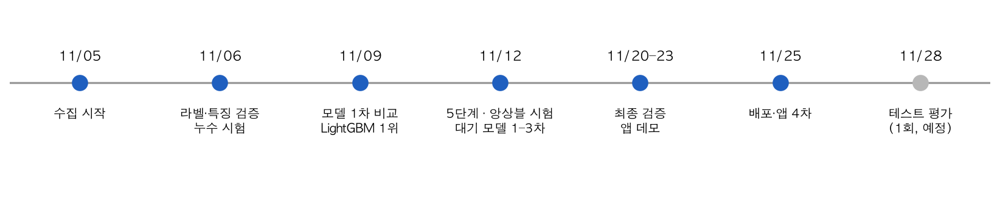

## 0. 한 장 요약

| 질문 | 답 |
| --- | --- |
| 무엇을 맞히나 | 정류장에 올 버스가 **도착할 때 남는 좌석**을 5단계(0 / 1–4 / 5–9 / 10–19 / 20+)의 확률로, 그리고 그 위에 **내가 앉을 확률** |
| 주 모델 | **LightGBM** 5단계 분류 (약 277회 × 5단계 = 트리 1,385개) |
| 왜 LightGBM | 후보 7개 중 출근 RPS·실제 만석에서 1위, 퇴근은 MLP·랜덤 포레스트와 거의 같음. 확률이 나오고, 학습이 빠르고, 서버(메모리 약 290MB)에 올릴 수 있음 |
| 시도했다가 버린 것 | 앙상블(만석에서 악화), 확률 보정(날마다 틀리는 방향이 바뀜), 곱셈식 대기 모델(내 앞 133명), isotonic 보정 |
| 가장 큰 한계 | 학습 데이터가 **평일 약 11일**뿐이고 평가도 며칠 단위다. 4정거장 이상 앞 버스의 중간 단계(1–9석)는 거의 못 맞힌다. 테스트 기간(11/24–27)은 아직 열지 않았다 |

## 1. 문제: 왜 어렵고 무엇을 평가해야 하나

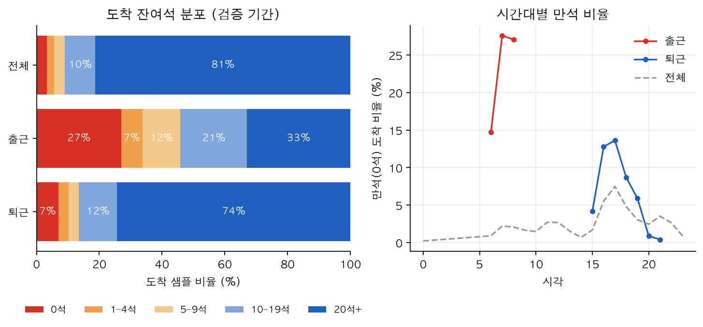

- 전체 도착의 **81%가 20석 이상**이라 전체 평균 점수는 쉬운 경우가 끌어올린다. 그래서 **핵심 구간(평일 출근 07–09시 서울행, 퇴근 17–22시 영통행 서울권)** 을 주 평가 대상으로 삼았다.
- 만석 비율은 전체 3.3%지만 **출근 27%**다. 우리가 알려야 하는 건 바로 이 경우다.
- 지표: **RPS**(단계가 순서 있는 확률의 오차, 낮을수록 좋음), **Brier**(P(≥k석) 확률의 제곱 오차), **macro-F1**(가장 높은 단계를 골랐을 때 단계별 F1 평균). 앱이 확률을 보여주므로 F1보다 RPS·Brier를 더 중시한다.
- 시간 순서로 나눴다: 학습 11/05–19, 검증 11/20–23, 테스트 11/24–27(최종 평가 때 한 번). 같은 날이 학습과 평가에 섞이지 않는다.
- 누수 시험: 어떤 시점 이후의 관측을 지우고 특징을 다시 만들었을 때 이전 샘플의 특징이 달라진 건수가 0이다. 이 시험으로 "앞차 기록이 도착 확인 전에 쓰이던" 실제 누수를 찾아 고쳤다.

### 1.1 왜 퇴근 샘플이 출근보다 18배 많은가

검증 기간(애매한 라벨 제외) 기준이다.

| | 샘플 | 예측 대상 정류장 | 시간대 | 버스 운행 수 | 운행 1회당 샘플 |
| --- | --- | --- | --- | --- | --- |
| 출근 | 3,976 | 11개 | 06–08시 | 74 | 약 35 |
| 퇴근 | 71,308 | 24개 | 15–21시 | 89 | 약 463 |

샘플 하나는 "버스를 한 번 관측한 시점 × 그 앞에 남은 예측 대상 정류장 하나"다. 그래서 샘플 수는 구간 길이와 관측 횟수가 정한다.

- **정류장 수**: 출근은 `경희대학교 → 청현마을` 11개, 퇴근은 서울권부터 도착권까지 24개.
- **구간에 머무는 시간**: 출근 버스는 캠퍼스에서 출발해 서울로 빠르게 빠져나간다. 퇴근 버스는 서울 도심 순환부터 수원 쪽까지 오래 달리며 계속 관측되고, 관측할 때마다 앞쪽 정류장이 여러 개 샘플로 붙는다.
- **시간대**: 퇴근 정의가 17–22시로 출근(07–09시)보다 넓다.

**하지만 독립적인 정보량은 샘플 수만큼 차이 나지 않는다.** 운행 수는 74대와 89대로 비슷하고, 같은 버스의 연속 샘플은 거의 같은 상황이다. 그래서 퇴근 점수가 더 안정적일 거라 기대하면 안 되고, 출근은 샘플도 적지만 평가 날짜도 평일 이틀이라 점수가 더 흔들린다. 4.3의 "실제 데이터 양은 운행 수와 날짜 수"가 같은 이야기다.

## 2. 후보 모델과 기준선

| 모델 | 왜 넣었나 |
| --- | --- |
| 과거 빈도 | 노선·정류장·시간대의 평소 분포. 아무것도 학습하지 않은 기준 |
| 현재 단계 유지 | "지금 버스의 잔여석 단계가 도착 때도 그대로". 가장 단순한 규칙 |
| 로지스틱 회귀 | 선형 모델의 하한 |
| 랜덤 포레스트 | 트리 앙상블 비교 대상 |
| **LightGBM** | 표 형태 데이터에서 강한 그래디언트 부스팅. 5단계 다중 분류 |
| 좌석 변화량 회귀 | 좌석을 직접 예측하고 오차 분포로 확률을 만듦 (회귀 접근) |
| MLP | 정류장 임베딩을 쓴 신경망 (GRU는 데이터가 더 쌓인 뒤로 미룸) |

## 3. 최종 비교 (검증 기간 11/20–23)

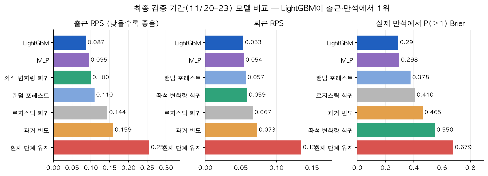
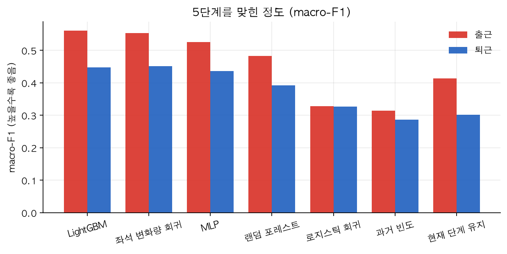

| 모델 | 출근 RPS | 퇴근 RPS | 실제 만석 P(≥1) Brier | 출근 F1 | 퇴근 F1 |
| --- | --- | --- | --- | --- | --- |
| **LightGBM** | **0.087** | **0.053** | **0.291** | **0.561** | 0.448 |
| MLP | 0.095 | 0.054 | 0.298 | 0.525 | 0.437 |
| 좌석 변화량 회귀 | 0.100 | 0.059 | 0.550 | 0.554 | **0.452** |
| 랜덤 포레스트 | 0.110 | 0.057 | 0.378 | 0.483 | 0.392 |
| 로지스틱 회귀 | 0.144 | 0.067 | 0.410 | 0.328 | 0.327 |
| 과거 빈도 | 0.159 | 0.073 | 0.465 | 0.315 | 0.287 |
| 현재 단계 유지 | 0.255 | 0.135 | 0.679 | 0.414 | 0.301 |

출근 3,976개, 퇴근 71,308개, 실제 만석 18,126개(애매한 라벨 제외).

- LightGBM은 RPS와 만석 Brier에서 1위다. 퇴근 F1만 좌석 변화량 회귀가 0.004 앞서는데, 같은 모델의 확률 품질(RPS·만석)은 훨씬 나빠서 의미가 없다.
- **좌석 변화량 회귀는 F1이 괜찮아도 만석에서 무너진다** (만석 Brier 0.550). 잔차를 몇 정거장 앞별로만 나눠 만석 근처의 오차 꼬리가 반영되지 않기 때문이다. "만석인데 자리 있다고 말하는 것"이 이용자에게 가장 해로운 오류라서 이 약점은 치명적이다.
- 가장 단순한 "현재 단계 유지"가 RPS는 가장 나쁘다. 지금 만석이어도 도착할 때는 사람이 내려 있을 수 있어서다.

## 4. 어떻게 발전했나: 회차별 기록

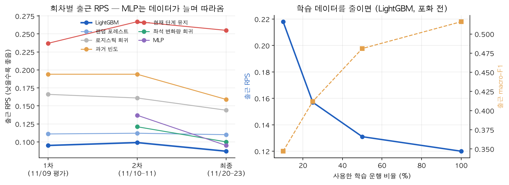

> 회차마다 평가 날짜가 달라서 **순위는 비교할 수 있지만 같은 모델의 점수를 회차 사이에 직접 비교하면 안 된다** (아래 4.2).

### 4.1 1차 → 2차 → 최종

| 시기 | 학습 | 평가 | 결과 |
| --- | --- | --- | --- |
| 기준선 (11/06) | 11/05 하루 | 11/06 오전 | LightGBM 출근 F1 0.516, 현재 단계 유지 0.481. 하루치로는 모델 성능을 말할 수 없다고 판단 |
| 1차 (11/09) | 11/05–08 | 11/09 오전 | LightGBM 1위 (RPS 0.095). 랜덤 포레스트 0.111 |
| 2차 (11/12) | 11/05–09 | 11/10–11 | 출근 LightGBM 우세, 퇴근은 랜덤 포레스트와 동률. **MLP는 1에폭 만에 과적합** (검증 손실 0.290 → 0.301 → 0.353) |
| 최종 (11/20) | 11/05–19 | 11/20–23 | MLP가 9에폭까지 학습되며 2위로 올라옴 (출근 F1 2차 0.375 → 최종 0.525) |

**배운 점**: 데이터가 늘수록 신경망이 따라온다. 그래도 LightGBM이 만석에서 가장 강하고 설명·배포가 쉬워 주 모델은 유지했다.

### 4.2 개선의 대부분은 "평가한 날이 달라서"였다

11/12 실험(11/10–11 평가)의 퇴근 RPS는 0.069였는데, **같은 5일 학습 모델이 11/20–23에서는 0.058**이다. 11/10–11은 퇴근 만석 12%로 붐볐고 11/20–23은 7%였다. 데이터가 늘어서 생긴 진짜 개선은 출근 0.099 → 0.087, 퇴근 0.058 → 0.053 정도다. 평가일이 몇 개 안 되는 지금은 날마다의 혼잡도가 모델 차이만큼 점수를 흔든다.

### 4.3 데이터가 얼마나 필요한가

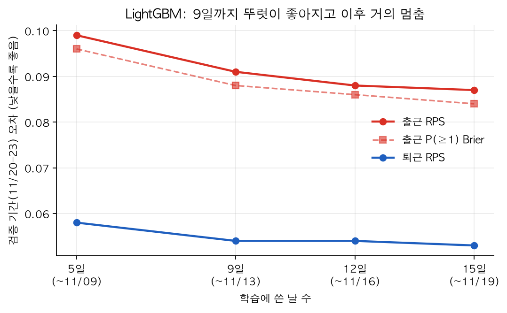

학습 일수가 5 → 9일일 때 뚜렷이 좋아지고 12일 이후 거의 멈춘다. 이 날 수가 현재 데이터의 한계 근처라는 뜻이기도 하다. 반대로 1차에서 학습 운행을 10%만 썼을 때 RPS가 0.218까지 나빠진 것(왼쪽 그림 오른쪽 패널)은 샘플 수(24만 개)보다 **운행 수와 날짜 수**가 실제 데이터 양이라는 증거였다.

## 5. 선택과 이유

### 5.1 좌석을 5단계로 나눴다 (10석 이상 → 10–19 / 20+)

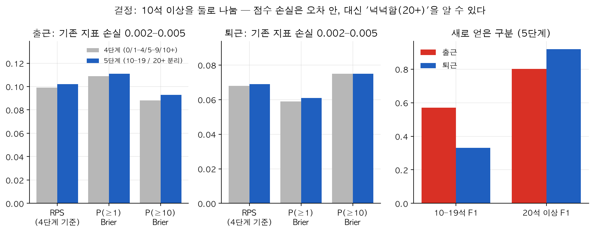

핵심 구간 도착의 45–72%가 "10석 이상" 한 칸에 몰렸다. 신논현(1대당 승차 15명)·살구골(13–15명)처럼 혼잡한 정류장에서는 10석과 30석의 의미가 다르다. 5단계로 바꿔도 기존 지표 손실은 0.002–0.005로 평가 이틀의 오차 안이었고, 대신 "20석 이상" 구분(F1 0.80/0.92)을 얻었다. 퇴근 10–19석 F1이 0.33으로 낮은 건 퇴근에는 10–19석 도착이 드물어서다.

### 5.2 단계 하나를 고르지 않고 누적 확률 P(≥k석)을 보여준다

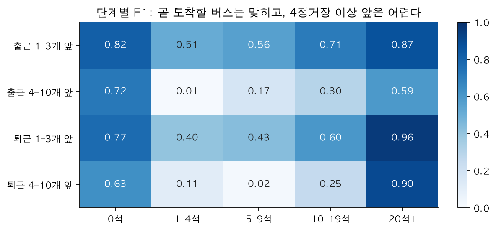

- **곧 도착할 버스(1–3정거장)는 중간 단계도 의미 있게 맞힌다.** 4–10정거장 앞에서는 1–4석 F1이 0.01–0.11로 거의 못 맞힌다.
- 그래서 앱은 먼 버스에 대해 "자리 있을 확률"과 "넉넉할 확률(20+)"만 보여주고 중간 단계 확정은 하지 않는다.

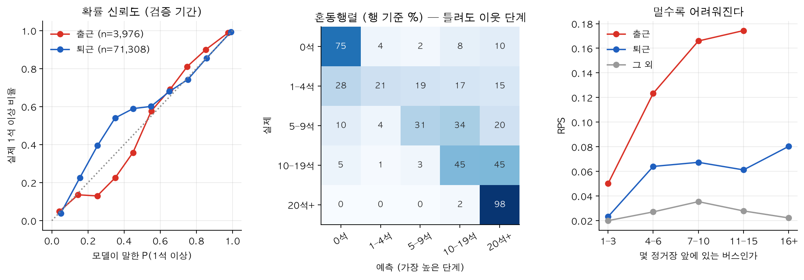

- 왼쪽: 모델이 말한 확률과 실제 비율이 대체로 대각선 위에 있다. 다만 **출근은 0.2–0.5 구간에서 낙관적**(말한 것보다 덜 맞음)이고 퇴근은 반대로 약간 비관적이다.
- 가운데: 틀려도 대부분 **이웃 단계**로 틀린다. 가장 해로운 방향(실제 만석 → 20석+)은 10%다. 다만 실제 1–4석의 28%를 0석으로 보는 건 보수적인 쪽의 오류다.
- 오른쪽: 멀수록 어렵다. 출근 RPS는 1–3정거장 0.05, 11정거장 이상 0.17.

### 5.3 앙상블은 쓰지 않았다

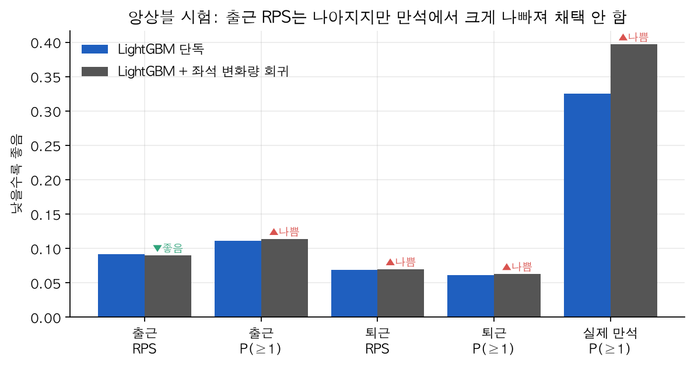

LightGBM과 좌석 변화량 회귀를 구간별 가중치로 섞었다. 출근 RPS와 P(≥10), P(≥20)은 조금 좋아졌지만(0.002–0.008, 평가 이틀의 오차 안) **P(≥1)이 나빠지고 실제 만석에서 크게 나빠졌다** (0.325 → 0.397). 변화량 회귀의 만석 과소 예측이 섞여 들어온 것이다. "앱에서 가장 중요한 쪽이 나빠진다"가 이유다.

### 5.4 확률 보정은 하지 않았다

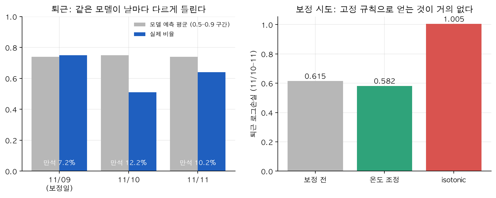

- 모델이 체계적으로 과신하는 게 아니라 **날마다 혼잡도가 달라서** 틀린다. 11/09에는 정확했고 11/10에는 0.75라고 한 구간의 실제가 0.51이었다.
- 하루로 배운 보정 규칙을 다른 날에 적용하면 효과가 거의 없었다. **isotonic은 확률을 0/1로 잘라 로그손실이 0.615 → 1.005로 악화**됐다. 온도 조정도 최종 검증에서 T≈1(변화 ±0.001)이었다.
- 대신 "오늘의 혼잡도" 특징(오늘 이미 지나간 버스들이 평소보다 얼마나 붐볐나)을 다음 과제로 남겼다. 아직 구현하지 않았다.

## 6. "내가 앉을 확률": 모델 위의 모델

잔여석 확률만으로는 "내가 탈 수 있나"에 답하지 못한다. 내 앞에 줄 선 사람 N명이 있기 때문이다.

```
P(내가 앉음) = Σ_s P(도착 잔여석 = s) × P(내 앞 인원 < s)
```

S의 분포는 LightGBM이 주고, N은 별도의 **대기 인원 모델**(`waiting.py`)로 추정한다. 사용자가 직접 세어 입력하는 A안도 있었지만 입력이 필요 없는 B안(자동 추정)을 택했다.

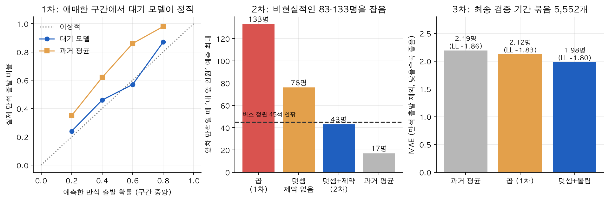

| 차수 | 바꾼 것 | 왜 |
| --- | --- | --- |
| 1차 | 음이항 분포로 버스 1대당 탑승 인원을 모델링. 앞차가 만석으로 떠나면 평균에 ×5.2 | 데이터에서 앞차 만석 시 다음 차 탑승이 1.5–2배. **애매한 구간의 확률이 과거 평균보다 정직** (왼쪽) |
| 2차 | 곱(×5.2) → 덧셈 (평소 승차 + 앞차가 남긴 사람) | 실제 정류장에서 "내 앞 83명"(평가 기간 최대 133명)이 나왔다. **정원이 45석 안팎인데 불가능한 값**. 제약 없이 학습하면 평가는 좋지만 계수가 비현실적(c=2.7, β=1.76)이라 **점수가 아니라 의미로 정한 제약**(c=1, 0≤β≤1)을 걸어 최대 43명 |
| 3차 | 같은 노선 버스가 2분 안에 오면 한 묶음으로 계산 | 수집이 2분 간격이라 그보다 가까운 두 버스의 순서를 알 수 없다. 묶음 전체가 줄을 소화하는 걸로 봄 |

한계도 적어 둔다: 줄 중간에 선 한 사람의 확률은 **직접 검증하지 못했다**. 확인한 건 "버스 직전에 온 마지막 사람이 앉나(만석 출발 여부)"다. β가 상한 1에 계속 붙는 것은 남은 사람을 여전히 적게 본다는 신호다. 현장 테스트(앞차 출발·내 도착 시각, 내 앞 인원, 착석 여부 기록)로 확인해야 한다.

## 7. LightGBM 안을 들여다보면

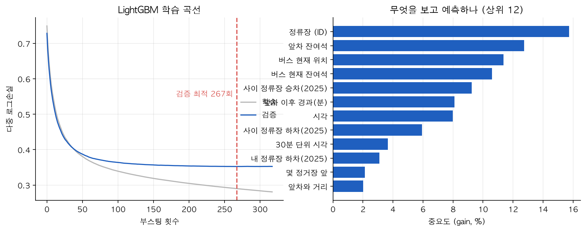

- 학습 곡선: 검증 손실이 50회 전후부터 거의 평평하다. 학습 손실만 계속 내려가므로 조기 종료가 필요했다. 데이터가 적을 때의 전형적인 모양이다.
- 중요도: **정류장 ID**가 가장 크다 (정류장마다 고유한 만석 패턴). 그다음이 앞차 잔여석, 버스 현재 위치·잔여석, 사이 정류장의 2025 승차 인원이다. **2025 승하차 데이터가 특징 상위권**에 들어와 쓸모가 있었다는 점이 확인된다.
- 주의: 정류장 ID 중요도가 높다는 건 "이 정류장은 평소 이렇다"를 외웠다는 뜻이다. 새 정류장이나 노선이 생기면 일반화가 안 될 수 있다.

## 8. 시행착오 한 줄 모음

| 시행착오 | 결과 |
| --- | --- |
| 앞차 기록이 도착 확인 전에 특징으로 쓰임 | 누수 시험으로 발견·수정 |
| 정류장 이름으로 고속도로 체크포인트를 걸렀더니 실제 승차 있는 곳까지 빠짐 | `(경유)` 표기 + 2025 일평균 승하차 10명 미만으로 변경 |
| 2511 승하차 파일이 2510과 동일 | 포털 업로드 문제로 확인, 10월만 사용 |
| 운행을 회차에서 끊었더니 퇴근길 영통행 승객이 빠짐 | 방향을 회차가 아닌 고속도로로 나눔 |
| 변화량 회귀가 만석을 과소 예측 | 주 모델 교체 기준(RPS·P(≥1) 둘 다 우세)을 못 넘어 보류 |
| MLP가 1에폭 만에 과적합 | 데이터가 늘어난 뒤 재시험, 2위로 상승 |
| 확률 보정이 오히려 악화 | 원인은 날마다의 혼잡도 차이, 보정 미적용 |
| 곱셈식 대기 모델이 "내 앞 83명" | 덧셈 + 제약으로 교체 |
| 학습·추론 특징이 달라질 위험 | 같은 함수를 공유, 실시간 특징이 학습 특징과 모두 일치함을 점검 |

## 9. 교차검증은 했나

**아니다. k-겹 교차검증은 하지 않았고, 날짜 기준 한 번 나눈 학습/검증/테스트와 학습 기간을 늘려 가며 보는 롤링 평가만 했다** (데이터 양에 따른 변화는 4.3).

이유 (프로젝트 계획서 7장과 설계에서 나온 것):

1. **일반 교차검증은 이 데이터에서 점수를 부풀린다.** 무작위로 겹을 나누면 같은 날·같은 운행의 연속 샘플이 학습과 평가에 섞여 들어간다. 연속 샘플은 거의 같은 상황이라 사실상 정답을 외운 채 평가하게 된다. 그래서 처음부터 날짜로 나눴다.
2. **미래를 학습에 쓰면 안 된다.** 실제 서비스는 과거로 학습해 앞날을 맞힌다. k-겹은 미래 날짜로 과거를 맞히는 겹이 생겨 실제 사용 상황과 다르다.
3. **시계열에 맞는 방식은 "롤링(확장 창) 검증"이다.** 이미 하고 있는 학습 5·9·12·15일 → 검증 기간 평가가 그 간단한 형태다.

**다만 약점은 분명하다.**

- 검증이 11/20–23 한 구간이라 **그 며칠이 유난히 쉽거나 어려웠다면 점수가 그대로 흔들린다.** 4.2에서 같은 모델의 퇴근 RPS가 평가 날짜만 바꿔 0.069 → 0.058이 된 것이 바로 이 문제다.
- 모델 비교(순위)는 여러 시험에서 같은 방향(LightGBM 우세)이라 믿을 만하지만, 소수점 단위의 차이나 앙상블 같은 작은 개선은 평가 날짜의 오차 안에 있다.
- 하이퍼파라미터 튜닝은 아직 하지 않았다. 튜닝을 하면 검증 구간에 과적합할 수 있으므로, 그때는 아래처럼 한다.

**보완 계획**: 날짜 단위 **시계열 교차검증**(확장 창: 학습 11/05–N일 → 다음 며칠 평가를 여러 번 반복, 같은 날은 절대 쪼개지 않음)으로 평가 오차 범위를 함께 보고한다. 데이터가 더 쌓이면 날짜 수가 늘어 겹을 더 만들 수 있다. 테스트 기간은 지금처럼 마지막에 한 번만 연다.

## 10. 정직한 한계와 앞으로

- **데이터가 적다.** 평일 약 11일, 교차검증 없이 검증 구간 한 곳(위 9장), 평가 며칠. 날마다의 혼잡도가 점수를 크게 흔든다. 순위는 믿을 만하지만 소수점 자리 차이는 의미가 없다.
- **테스트 기간(11/24–27)은 아직 평가하지 않았다.** 최종 평가는 한 번만 한다(11/28 예정). 지금까지의 모든 수치는 검증 기간 기준이라 약간 낙관적일 수 있다.
- 앱의 "내가 앉을 확률"은 **현장 검증 전**이다.
- 이 리포트의 1·2차 비교, 데이터 양, 4/5단계, 앙상블, 보정, 대기 모델 그림은 당시 `DECISIONS.md`에 기록한 표의 숫자다 (원본 산출물이 이후 실행으로 덮어써져 다시 읽을 수 없다). 최종 비교, 문제 정의, 신뢰도·혼동행렬, LightGBM 곡선·중요도는 저장소 파일에서 직접 계산했다.

**다음 과제**: 오늘의 혼잡도 특징 → LightGBM 튜닝(검증 기간) → 테스트 기간 1회 평가 → 현장에서 30–50건 검증 → 대기 모델 β 재검토 → GRU.
